# 💻 Awesome CLI Scripting & Terminal UI Tools 🚀

  
  
  
  
  
  

**A curated index of best-in-class Terminal User Interface (TUI) frameworks, CLI argument parsers, ANSI styling libraries, shell script prompt enhancers, and cloud/browser terminal services.**

*Empowering developers across Go, Rust, Python, TypeScript, Node.js, and Shell to build modern, beautiful, and interactive command-line experiences.*

---

## 📑 Table of Contents

- [📊 Sector Overview & Market Dynamics](#-sector-overview--market-dynamics)
- [☁️ SaaS & Hosted Platforms](#️-saas--hosted-platforms)
- [🛠️ Open-Source GitHub Projects](#️-open-source-github-projects)
  - [Top Frameworks & Utilities (Sorted by GitHub_Stars ⭐)](#top-frameworks--utilities-sorted-by-stars-)
  - [Architectural Stacks & Tooling Combinations](#architectural-stacks--tooling-combinations)
- [🤝 How to Contribute](#-how-to-contribute)
- [💖 Support & Share](#-support--share)
- [📈 Star History](#-star-history)
- [⚠️ Disclaimer](#️-disclaimer)

---

## 📊 Sector Overview & Market Dynamics

The global developer tools and command-line interface ecosystem is currently estimated at approximately **$15B–$16B**, expanding at a ~15% CAGR toward broader cloud and developer infrastructure segments. 

The market exhibits a distinct bifurcation:
- **Modular Utility Layer (Extreme Fragmentation)**: The CLI utilities, styling toolkits, and local TUI frameworks market is deeply fragmented across programming languages (Go, Rust, Python, JavaScript/Node.js). Thousands of independent open-source packages thrive and compete for community mindshare with high developer velocity and modular composability.
- **Platform & Cloud Terminal Layer (Heavy Concentration)**: In contrast, remote browser terminal workspaces, managed agentic dev environments, and distribution chokepoints are heavily concentrated among mega-cap tech ecosystems (Microsoft/GitHub, AWS) and high-valuation venture-backed platforms (Replit, Warp).

---

## ☁️ SaaS & Hosted Platforms

| Platform | Company Valuation / Revenue Scale | Starting Pricing | Free Tier Limits | Description |
| :--- | :--- | :--- | :--- | :--- |
| **[Fig / Amazon Q Developer CLI](https://amazon.com)** | **~$2.1T+ Market Cap** (Parent: Amazon AWS; Q Dev product unit) | **$19/user/month** (Amazon Q Pro tier) | **Free forever plan**: 50 agentic requests/month, 1,000 lines of code transformation/month, and basic security vulnerability scans via AWS Builder ID. | Cloud-backed terminal autocomplete, CLI assistant, and code transformation overlay with visual parameter menus. |
| **[GitHub Codespaces & Web Terminals](https://github.com)** | **~$2B+ ARR** (Acquired for $7.5B by Microsoft, ~$3.1T+ Market Cap) | **~$0.18/hour** (2-core compute pay-as-you-go overages) or **$4/user/mo** (GitHub Team) | **Free forever plan**: 120 core hours/month and 15 GB of persistent storage/month on personal accounts. | Managed cloud development environments offering browser-hosted and SSH-accessible terminals for interactive TUI applications. |
| **[Replit & Cloud Shell Workspaces](https://replit.com)** | **$9.0B Valuation** (~$240M Revenue / $150M+ ARR) | **$25/month** (or $20/mo billed annually for Replit Core) | **Free forever plan**: 1 public repl deployment, shared compute (0.5 vCPU, 512MB–1GB RAM), apps sleep after 5 minutes of inactivity, limited daily AI completions. | Browser-based collaborative development platform providing hosted PTY terminal sessions and interactive CLI deployments. |
| **[Warp (Cloud-Synced Terminal & Workflows)](https://warp.dev)** | **~$500M+ Valuation** ($75M–$85M+ total venture funding; tens of millions ARR) | **$20/user/month** (or $18/mo billed annually for Build tier) | **Free forever plan**: Unlimited modern terminal access, up to 3 indexed codebases, Bring-Your-Own-Key (BYOK) AI agent access (0 bundled managed agent credits included). | Modern GPU-accelerated terminal featuring cloud-synced CLI workflows, team script sharing, and AI coding agents. |
| **[Charm Cloud & Wish Hosted Ecosystem (`charm.sh`)](https://charm.sh)** | **Seed-stage (~$6M venture funding raised** led by Gradient Ventures) | **$10/month** (Shred Diet plan for Charm Hyper) or $5 prepaid credit pack | **Free forever plan**: 100% free open-source TUI libraries, self-hosting (`charm serve`), and Crush terminal coding agent using Bring-Your-Own-Key (BYOK). | Cloud services, inference routing (Hyper), and developer infrastructure built around Charm's CLI/TUI tools. |
| **[Textualize Cloud / Textual Web](https://textualize.io)** | **Seed-stage venture-backed** (raised undisclosed seed from Costanoa Ventures; wound down commercial operations) | **$0/month** (Free & 100% open-source under MIT; commercial cloud service retired) | **Free forever plan**: Unlimited full access to self-hosted `textual-web` WebSocket server and Python Textual framework without commercial usage caps. | Hosted web-serving and open-source WebSocket runtime enabling Python `Textual` TUI apps to render directly inside web browsers. |

---

## 🛠️ Open-Source GitHub Projects

### Top Frameworks & Utilities (Sorted by GitHub_Stars ⭐)

- **[fzf (`junegunn/fzf`)](https://github.com/junegunn/fzf)**   
  ⚡ General-purpose, blazing-fast command-line fuzzy finder written in Go, ubiquitous for interactive shell search, file navigation, and CLI completion workflows.

- **[bat (`sharkdp/bat`)](https://github.com/sharkdp/bat)**   
  🦇 A modern `cat` clone written in Rust featuring syntax highlighting for a vast range of programming languages, Git integration, and automatic terminal paging.

- **[Rich (`Textualize/rich`)](https://github.com/Textualize/rich)**   
  🌈 Essential Python library for rendering rich text, beautiful ANSI colors, syntax-highlighted code, tables, progress bars, and markdown directly in the terminal.

- **[Bubble Tea (`charmbracelet/bubbletea`)](https://github.com/charmbracelet/bubbletea)**   
  🍵 The fun, powerful, and ultra-popular Go TUI framework based on The Elm Architecture (Model-Update-View) for crafting elegant, stateful terminal apps.

- **[fd (`sharkdp/fd`)](https://github.com/sharkdp/fd)**   
  🔎 A simple, fast, and user-friendly alternative to `find` written in Rust with intuitive syntax, colorized terminal output, and regex matching.

- **[Cobra (`spf13/cobra`)](https://github.com/spf13/cobra)**   
  🐍 Industry-standard Go library for creating modern CLI applications with nested subcommands, POSIX flags, and auto-generated shell autocompletions (powers Kubernetes, Hugo, GitHub CLI).

- **[Ink (`vadimdemedes/ink`)](https://github.com/vadimdemedes/ink)**   
  ⚛️ React for interactive command-line apps. Use standard JSX components, hooks, and Flexbox layouts powered by Yoga to build rich terminal experiences in Node.js.

- **[Textual (`Textualize/textual`)](https://github.com/Textualize/textual)**   
  🐍 Modern Python Rapid Application Development (RAD) framework for building sophisticated terminal user interfaces with CSS-like styling, mouse support, and WebSockets.

- **[delta (`dandavison/delta`)](https://github.com/dandavison/delta)**   
  📑 A syntax-highlighting pager for git, diff, and grep output featuring side-by-side view, line numbers, and custom color themes written in Rust.

- **[Glow (`charmbracelet/glow`)](https://github.com/charmbracelet/glow)**   
  🌟 Terminal-based markdown reader designed from the ground up to render markdown beautifully on the CLI with custom palettes, stash, and pager support.

- **[Gum (`charmbracelet/gum`)](https://github.com/charmbracelet/gum)**   
  🍬 Flagship tool written in Go for adding glamorous interactive prompts, multi-selects, spinners, fuzzy filters, tables, and styled output directly into Bash/Zsh shell scripts.

- **[Ratatui (`ratatui/ratatui`)](https://github.com/ratatui/ratatui)**   
  🦀 Leading lightweight Rust library for cooking up terminal user interfaces with immediate-mode rendering, rich layout constraints, charts, and crossterm/termion backends.

- **[Inquirer.js (`SBoudrias/Inquirer.js`)](https://github.com/SBoudrias/Inquirer.js)**   
  ❓ Classic, battle-tested collection of interactive command-line user interfaces and prompts for Node.js CLI tools and interactive setup wizards.

- **[VHS (`charmbracelet/vhs`)](https://github.com/charmbracelet/vhs)**   
  📼 Write terminal demonstrations and CLI/TUI integration tests as pure code (`.tape` files) and generate pixel-perfect animated GIF and MP4 recordings in CI.

- **[Typer (`fastapi/typer`)](https://github.com/fastapi/typer)**   
  ⌨️ Great developer ergonomics library for building CLI applications in Python based on Python type hints, created by the author of FastAPI.

- **[Clap (`clap-rs/clap`)](https://github.com/clap-rs/clap)**   
  👏 Full-featured, blazingly fast Command Line Argument Parser for Rust offering declarative derive macros, subcommands, and shell autocompletions.

- **[Termui (`gizak/termui`)](https://github.com/gizak/termui)**   
  📊 Cross-platform Go terminal dashboard and widget library built on `termbox-go` for rendering sparklines, bar charts, gauges, and grid-based system monitors.

- **[ttyd (`tsl0922/ttyd`)](https://github.com/tsl0922/ttyd)**   
  🌐 Simple command-line tool for sharing any local CLI application, shell session, or TUI app over the web via WebSockets with zero cloud lock-in.

- **[Lip Gloss (`charmbracelet/lipgloss`)](https://github.com/charmbracelet/lipgloss)**   
  💄 Style definitions for nice terminal layouts using CSS-like declarative rules, borders, padding, margins, colors, and tables in Go.

- **[Prompts (`terkelg/prompts`)](https://github.com/terkelg/prompts)**   
  💬 Lightweight, zero-dependency JavaScript prompt library providing intuitive interactive inputs, multi-selects, confirmations, and autocompletes.

- **[Clack (`natemoo-re/clack`)](https://github.com/natemoo-re/clack)**   
  🔔 Beautifully crafted, effortless CLI prompt toolkit for Node.js and TypeScript featuring spinners, multi-selects, text inputs, and clean modern terminal typography.

- **[sd (`chmln/sd`)](https://github.com/chmln/sd)**   
  ⚡ Intuitive find & replace CLI written in Rust, serving as an ergonomic and significantly faster alternative to `sed` and `awk`.

- **[Huh? (`charmbracelet/huh`)](https://github.com/charmbracelet/huh)**   
  📋 Interactive, accessible terminal forms and multi-step prompt workflows built directly on top of Bubble Tea and Lip Gloss in Go.

- **[Chafa (`hpjansson/chafa`)](https://github.com/hpjansson/chafa)**   
  🖼️ High-performance character art and ANSI image/graphics generator for the terminal supporting sixel, Kitty graphics protocol, and Unicode block art.

- **[Freeze (`charmbracelet/freeze`)](https://github.com/charmbracelet/freeze)**   
  📸 Generate gorgeous image snapshots and code screenshot banners directly from terminal output, code snippets, or markdown.

---

### Architectural Stacks & Tooling Combinations

- **Interactive Shell Scripts**: Combine **`charmbracelet/gum`** with **`fzf`** and **`bat`** for glamorous, interactive shell prompts and fuzzy navigation with zero binary compilation.
- **Go Full-Featured TUIs**: Pair **`Bubble Tea`** (state machine & event loop) + **`Lip Gloss`** (layout & ANSI styling) + **`Huh?`** (multi-page user forms) + **`Cobra`** (command-line argument routing).
- **Python Modern Terminal Apps**: Pair **`Textual`** (reactive CSS-based widgets) + **`Rich`** (markup, syntax highlighting & tables) + **`Typer`** (type-hint CLI parser).
- **Rust High-Performance TUIs**: Combine **`Ratatui`** (immediate mode rendering) + **`Clap`** (declarative argument parsing) + **`crossterm`** (cross-platform event loop).
- **TypeScript / Node.js CLIs**: Use **`Clack`** or **`Inquirer.js`** for interactive prompts, **`Ink`** for React-based full terminal UIs, and **`Commander`** for option parsing.
- **Web & CI Distribution**: Use **`ttyd`** to broadcast terminal sessions via WebSockets over the internet and **`VHS`** to record automated, reproducible `.tape` GIF demos in GitHub Actions.

---

## 🤝 How to Contribute

Contributions are warmly welcomed! To suggest a new tool or update existing details:

1. 🍴 **Fork this repository**.
2. 🌿 Create a feature branch: `git checkout -b add-tool-name`.
3. 📝 Add or edit your entry in `README.md` (keep descriptions objective, link official repos, and follow existing badge styling).
4. 🚀 Push to your branch and open a **Pull Request**.

⭐ Don't forget to **star the repository** if you find it helpful!

---

## 💖 Support & Share

If you find this curated collection useful for your development workflow or terminal craftsmanship, here is how you can support the project:

- ⭐ **Star this repository** to help others discover it across GitHub.
- 🍴 **Fork & Share** it with your engineering team, terminal fans, and developer communities on X/Twitter, LinkedIn, and Reddit.
- ☕ **Buy me a coffee / Sponsor**: Support ongoing maintenance and curation via the [GitHub Sponsors Dashboard](https://github.com/sponsors/ishandutta2007) — featuring tiers for profile badges, README shoutouts, logo placements, and prioritized reviews!

  

---

## 📈 Star History

---

## ⚠️ Disclaimer

- This is a **community-curated index** — not an exhaustive database and not a commercial endorsement.
- `Lip Gloss`, `Cobra CLI`, `Bubble Tea`, and `Termui` are open-source libraries at their core; cloud references describe hosted web/SSH bridges.
- When exposing interactive TUI applications over SSH (`Wish`) or HTTP/WebSockets (`ttyd`, `Textual Web`), always enforce authentication, sandboxed execution, and rate limiting.

---

  Crafted with ❤️ for CLI developers, DevOps engineers, terminal craftsmen, and open-source contributors.

